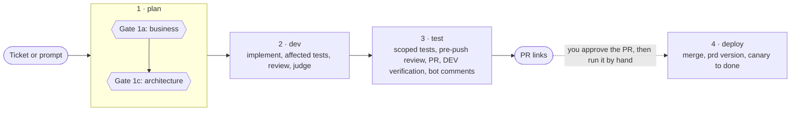

A run has four phases and one state file. In the `full` lane you decide twice, both times before any code is written. The `quick` and `hotfix` lanes ask once. If the session can write, the run then goes unattended to green PRs. Deploy never starts on its own.

The two hexagons are the only human gates of a `full` run. Phase 4 runs only when you type `/pit-crew:deploy`, after a reviewer approves the PR.

## Phase by phase

### 1. Plan

You start it with `/pit-crew:plan`, followed by a ticket id or a description. The run first asks what kind of task it is, unless you gave the type ([Lanes](../lanes/)). If the request is a bug, a read-only triage runs first and reports a root cause. The business analyst then interviews the request and drafts a short spec with no technical vocabulary. That is Gate 1a. After you approve it, the run creates the ticket when a `tracker` role is connected. Then it designs the architecture: which services, which tables, sync, async or cron. On a `full` run that needs one, it publishes a plan page before Gate 1c. Each gate closes with the two-line recap. Before Gate 1c the recap adds one line naming the checks lost to roles that are off or `partial` (on, with a required verb missing). [Plan in detail](../plan/).

**You decide:** whether the business spec is right (1a), and whether the design is right (1c). You also answer the open design questions, which come first.

**You get:** an approved two-line recap, a ticket when a tracker is connected, and a plan page when the change needs one.

### 2. Dev

Phase 2 creates a git worktree per repo, outside your clone. It implements the approved design, inline for a trivial change or through a Builder agent otherwise. It runs the added or changed tests plus the closest affected ones. The review is proportional to the risk. An adversarial judge checks the whole diff against the ticket and the acceptance criteria, except on `quick` and `hotfix`. If the diff drifted from the criteria, phase 2 loops internally. It does not ask you and does not move on with a known gap. [Dev in detail](../dev/).

**You decide:** nothing. Approving Gate 1c authorized this run's branches, commits and PRs.

**You get:** committed branches in worktrees that build, with their affected tests green.

### 3. Test

Phase 3 runs the test scope sized for each repo, never the whole suite. Then comes the pre-push review: a standards pass (not on `hotfix`), a secret scan, and the local LLM review when `prepush_mode` says `llm`. The run pushes, opens the PRs and writes an early retro when the run earned one. It verifies each acceptance criterion in DEV when an `env` role is connected. It resolves the review comments of bots and humans. It then writes the report, a final retro when there is news, and removes the worktrees that hold no work. [Test in detail](../test/).

**You decide:** nothing, unless a step touches production or finds a secret already committed. Those two always ask.

**You get:** PR links, each body with its evidence, and a report that repeats your approved recap word for word.

### 4. Deploy

Phase 4 is manual. You run `/pit-crew:deploy` with the run's state path once every PR is approved. It merges the PRs one at a time and confirms the version in production. Then it drives each service's rollout to the end. With `--driver human`, you merge and advance each step while it monitors and recommends. It stops and asks at a safety stop: a freeze, a busy environment, a rollback or a canary window with nothing observed. With no `deploy` role connected, it asks you once before the first merge, merges only on a yes, and does not watch the rollout. [Deploy in detail](../deploy/).

**You decide:** when to deploy, who drives the canary steps, and what to do at each safety stop.

**You get:** merged PRs, a per-service report, and a deleted state folder once every rollout completed.

## What chains into what

| From | To | When |
|---|---|---|
| Plan | Dev | Always, once Gate 1c is approved and a probe proves the session can write. With or without `--auto`. |
| Dev | Test | Always, in the same run, unless phase 2 hands off to a fresh session. |
| Test | Deploy | Never. You run `/pit-crew:deploy` by hand. |

`--auto` does not skip the gates. It only skips the task-type question, and it still asks for `hotfix`.

## Interruptions and resume

The state file lives at `~/.claude/pit-crew/<slug>/state.json`, outside every repo. It survives a compact, a session cut and the switch from plan mode to open permissions. The state file is the resume point.

| What happened | What you see | What you do |
|---|---|---|
| The session could not write after Gate 1c | One line saying so, the state path, and a `/pit-crew:dev` line | Open permissions and run that line |
| A `git push` or `gh` call was denied | The phase stops with `needs_input` and a `/pit-crew:test` line | Fix the access and run that line |
| Phase 2 handed off: context warning, a second round of fixes, or three or more repos | A `/pit-crew:test` relaunch line | Run it in a fresh session |
| The run stopped `blocked` | What is missing, and the phase to re-run | Fix the cause, then re-run that phase |

`/pit-crew:dev` and `/pit-crew:test` take a state path. With none, they use the most recently updated run and say which. `/pit-crew:plan` also accepts a state path: it says where the run stands and continues from the first unfinished step. A handoff is not a failure. Nothing is deleted on a stop. See [State and reports](../state-and-reports/).

## Next

- [Lanes](../lanes/): `full`, `quick`, `hotfix` and the light lane.
- [Plan](../plan/): the two gates in detail.
