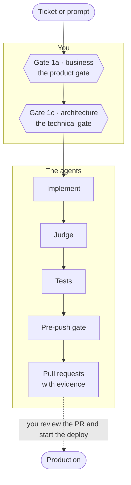

Put your time and your attention here. A `full` run has exactly two human gates, and both come before any code exists. Everything the agents do afterwards is measured against what you approve at these two points.



The plugin calls them **Gate 1a · business** and **Gate 1c · architecture**. This site also calls them the product gate and the technical gate, because that is what you decide at each one.

| | Gate 1a · business | Gate 1c · architecture |
|---|---|---|
| Also called | the product gate | the technical gate |
| You decide | what the change does, for whom, and how you will know it works | how it is built: services, data, contracts, risks |
| The artifact | a business spec with observable acceptance criteria | a decision table, and a plan page when the change needs one |
| Vocabulary | plain words, nothing technical | technical |
| It closes with | the two-line recap | the two-line recap, plus the checks that will be reported as not tested |

The `quick` and `hotfix` lanes have one gate, labelled Gate 1c. See [Lanes](../lanes/).

## Before the gates: questions that matter

The run asks only real questions: two reasonable answers that lead to different code or design, which the code, the data or the conversation cannot settle. It looks facts up instead of asking them. Zero questions is a valid outcome.

Every question puts the recommended option first, with one line on why. The last option is always **"I don't understand"**. Pick it and the run explains the question again with an example from your request.

## Gate 1a · business, the product gate

You are setting the tolerances. This gate fixes what "done" means before anyone argues about how.

**What you validate**

- **The business spec.** At most one page, with no technical vocabulary. It comes out of an interview about the business only: who, which scope, money, failures, edge inputs, what users see, rollout and support.
- **The acceptance criteria.** Each one observable. Later, the PR reports every criterion as proved or not tested, so a vague criterion here becomes an unprovable line there.
- **The "Closed without asking" block.** Each line is a point the run decided on its own, with its source: a line of code, data, your own words or an earlier decision. A ticket is never a source. Approving the gate confirms every line.

**What to answer**

- **"Approve except…"** names a line you disagree with. It is reopened as a real question before approval.
- **Edge scenarios, honestly.** The run may describe one concrete case and ask what should happen. If you cannot answer, that is a finding, not a failure.
- **"just do it"** takes its defaults. It still shows you one confirm round, so nothing is assumed unseen.

After you approve, the run creates the ticket when a `tracker` role is connected.

## Gate 1c · architecture, the technical gate

You are designing the process. This is the last human step before the pull requests.

**What you validate**

- **The decision table.** Which repos and services change, the data changes, how they talk to each other, the contracts and the risks. Open design decisions are asked before the table, so the table shows answers, not options.
- **The plan page**, when the change needs one. It has a Product tab and a Technical tab, with the architecture diagram in the Technical tab. The gate question carries its link. Read it first: a hook refuses a Gate 1c question asked before the page is published.
- **The not-tested list.** Under the table you see what the preflight could not provide, and which checks will be reported as not tested because of it.
- **The two-line recap.** One business line, one architecture line. The final report repeats it word for word.

**What to answer**

- **Check the not-tested list.** If a check matters to you, connect the missing role before you approve.
- **Push back with a concrete alternative.** The run is told to do the same when a design is weak.
- **Approve only when you would ship it.** After this gate there is no human step until the PR links.

Approving Gate 1c authorizes this run's branches, commits and pull requests, in the repos the architecture listed. It never covers a merge, a force-push or another repo.

## What is not your job

- **Choosing a service or a table at Gate 1a.** If you name one, the run notes it and steers back to business. That decision has its own gate.
- **Writing the code.** After Gate 1c the agents implement. You do not go back to typing.
- **Watching the rest of the pipeline.** If the session can write, the run continues on its own to green PRs. It stops only for an action on production or a secret already committed.
- **Remembering what you agreed to.** The recap you approved comes back word for word in the final report.

## What the artifact looks like

Each gate closes with this recap. It is the plugin's template; the placeholders stay as written.

```text
<localized business label>: <2-3 jargon-free lines: problem and user-visible change>
<localized architecture label>: <2-3 lines: services, table changes or none, sync/async/cron>
```

[A worked example](../../getting-started/worked-example/) follows one bug through both gates with the plugin's own templates and eval cases.

## Next

- [What the agents do](../what-the-agents-do/): from Gate 1c to green PRs.
- [Plan](../plan/): the whole planning phase, step by step.
