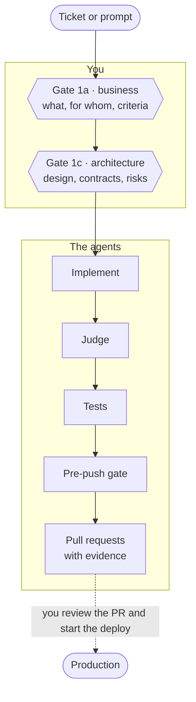

import { Card, CardGrid } from '@astrojs/starlight/components';
import Video from '../../components/Video.astro';
import banner from '../../assets/pit-crew-banner.svg';

## What it is

Pit Crew is a crew of agents that works next to the engineer, inside Claude Code. The engineer decides what gets built, for whom and with which architecture. The agents help think it through, write the code, test it, review it and come back with a pull request and the proof for each criterion. It works on any repo, and each company connects its own tools.

Think of a racing team. You are the driver, and you decide the strategy. Race engineers help you design and plan the change. The pit crew builds and tests it fast. Telemetry and the pit wall review it and check it against evidence. After every race there is a debrief, and each run leaves the crew better for the next one.

## What you decide, what your crew does

| What you decide | What your crew does |
|---|---|
| What gets built and for whom: the business spec and its acceptance criteria, at Gate 1a | Interviews you about the business, then drafts the spec and the criteria for you to correct |
| How it is built: services, data, contracts and risks, at Gate 1c | Reads the code, finds what the change touches, and drafts the design and the plan page you read |
| Whether the pull request is right | Writes the code, tests it, reviews it before the push (on a `full` run, with a separate judge), and opens the PR with the proof for each criterion |
| When to start the deploy, and what to do at each safety stop | Merges the approved PRs and watches the rollout, once you start it |
| What changes when a run goes wrong | Writes the retro that says what blocked or surprised the run |

Three principles hold it together:

1. **You decide, they execute with you.** There are two decisions before any code exists: the business one at Gate 1a and the architecture one at Gate 1c. The agents help you reach both, then do the work up to the pull request.
2. **Nothing without proof.** Each acceptance criterion comes back proved or marked as not proven. On a `full` run, a different agent from the one that wrote the code reviews it; the [lanes](how-it-works/lanes/) say which reviews a `quick` or `hotfix` run skips.
3. **Every lap leaves the crew better.** A run that was blocked or retried ends in a retro, and its lesson goes into the process.

[Why Pit Crew](how-it-works/why/)

## How you work: two gates

Your time goes to two decisions, and both come before any code exists. The agents help you get there: they interview you, read the code and draft what you approve.

- **Gate 1a · business**, the product gate. What the change does, for whom, and the acceptance criteria. No technical vocabulary.
- **Gate 1c · architecture**, the technical gate. The design, the contracts between services, the data changes and the risks.

At each gate you validate an artifact, not a conversation: a business spec, then a decision table and a plan page. Each gate closes with a two-line recap. That recap is what you approve, and the final report repeats it word for word.

[Where you work: the two gates](how-it-works/your-two-gates/)

## What the agents do

After Gate 1c you do not go back to typing code. If the session can write, the run continues on its own:

1. It implements the approved design in a git worktree, never in your clone.
2. It runs the tests the change affects.
3. On a `full` run an adversarial judge attacks the whole diff against the ticket and the acceptance criteria.
4. It runs the pre-push gate: a standards pass and a secret scan.
5. It opens the pull requests, verifies each acceptance criterion and answers the review comments.

It stops at green PR links, each with its evidence in the body.

:::note[Where the unattended part ends today]
A run ends at green pull requests. A person reviews and approves them, and you start the merge and the rollout yourself with `/pit-crew:deploy`. A run that continues to production on its own does not exist. That gap is roadmap, not a feature.
:::

[What the agents do](how-it-works/what-the-agents-do/)

## Guarantees

An unattended run is only worth trusting if you can check it afterwards and if some mistakes cannot happen at all.

<CardGrid>
  <Card title="Evidence" icon="document">
    Every acceptance criterion comes back with its proof in the PR body. A criterion the run could not prove is reported as not tested. It never closes green on a guess.
  </Card>
  <Card title="Guards" icon="warning">
    Hooks deny the riskiest actions before the tool call runs: a force-push, a merge that skips the repo's rules, a whole-suite test run, a write by a read-only agent.
  </Card>
  <Card title="A judge" icon="magnifier">
    The agent that wrote the code does not grade it. On a `full` run a separate judge treats the diff as wrong until the code proves otherwise.
  </Card>
  <Card title="Hard caps" icon="error">
    A red build or test gets three fix rounds. A fourth is refused and the run stops with the log path.
  </Card>
</CardGrid>

[Guarantees](how-it-works/guarantees/)

## A portable core, and connectors

The core is portable: plan, implementation, judge, pre-push gate and pull request, on top of `git` and `gh`. It names no company tool.

Everything specific to a company comes in through a connector. A tracker, a knowledge base, a test environment, logs, a database, review bots and a deploy tool are **roles** you connect. With none connected, a run still plans with two gates, implements, tests, reviews and opens the PRs. Each step that needs a missing role is skipped and recorded, and the report says what was not tested.

A **pack** is a second plugin that connects one organisation's tools in one install.

[Roles and bindings](roles/) · [Packs](packs/)

## See a run

<Video name="pit-crew-for-engineers" title="Pit Crew for engineers" />

*5:48, for engineers. The ticket, test environment and logs it shows come from the roles you connect. More in [Videos](getting-started/videos/).*

[A worked example](getting-started/worked-example/) follows one bug from the report to the rollout, using the plugin's own templates and eval cases.

## Install and reference

When you want to run it:

- [Install](getting-started/install/) and [Your first run](getting-started/first-run/).
- [Reference](reference/commands/): every command, flag, skill, agent and hook.
