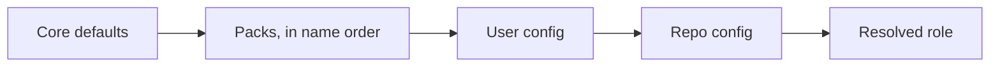

The core runs in any company with no company host, token or tool in it, and it sends nothing anywhere by default. Each company connects its own tools. This page is the contract that makes both true. Read it before you write a pack or an adapter.

## Goals

1. You install `pit-crew` and it works with no company host, token or tool.
2. Each company connects its own MCP servers, one role at a time.
3. A company installs the core plus its pack and gets its full behaviour back.

## Vocabulary

| Term | Meaning |
|---|---|
| Role | A job an external tool does for the pipeline. There are nine: `tracker`, `docs`, `env`, `logs`, `data`, `review`, `deploy`, `events`, `stack` |
| Verb | One action inside a role, such as `env.up` or `tracker.create`. Core text names a role and a verb, never a tool |
| Adapter | The guide that says how one tool fills a role. It names verbs and settings, never a company value |
| Binding | What you supply for a role: which adapter, which MCP tool fills each verb, and the `settings` |
| Pack | A plugin that supplies bindings, adapters and MCP servers for one organisation, with a `pack.json` at its root |
| Config | `~/.claude/pit-crew/config.json` for a person or an organisation, and `<repo>/.pit-crew/config.json` for one repo |

## How a role resolves

Every role starts from a core default: off, except `stack`, which is `generic`. Then each layer sets the roles it mentions, and a higher layer wins.

The merge rules are simple:

- Scalars replace the lower value: `enabled`, `adapter`, `guide`, `server`.
- `tools` and `settings` merge key by key. A key set to `null` is removed.
- `"enabled": false` in a higher layer turns the role off.
- A role a layer does not mention keeps its lower value.

The repo layer is narrow on purpose. It sets `stack`, the roles the repo `requires`, and for `env` only `settings` or `enabled: false`. It never names a tool id, a server or an `env` adapter, because the file arrives with the branch.

Packs are found in this order, first source that answers: `PIT_CREW_PACKS`, then the `packs` list of the user config, then the registry the packs' SessionStart hooks write. See [Packs](../) for the detail.

### What a resolved role holds

The resolver prints each role as one object. You see it when you run `node scripts/roles.cjs` from the plugin folder.

| Field | Meaning |
|---|---|
| `enabled` | Whether the role is on |
| `status` | `on`, `off` or `partial`. Partial means on, with a required verb missing |
| `missing_verbs` | The required verbs a partial role lacks |
| `adapter` | The adapter name |
| `source` | The layer that last set the role: `core`, `pack:<name>`, `config:user` or `config:repo` |
| `guide` | An absolute path to the adapter guide |
| `server` | The MCP server the tools come from |
| `tools` | Verb to tool id, with its access |
| `settings` | The values the guide reads |

The output carries `contract: "roles/v1"`. Within v1 it only gains fields. No field is renamed or removed.

## Roles and their verbs

| Role | Verbs | Off means |
|---|---|---|
| `tracker` | `get`, `create`, `search`, `update`, `list_teams`, `get_project`, `labels` | The run goes without a ticket |
| `docs` | `search`, `fetch`, `update`, `comment` | No company knowledge lookup. Terms come from the repo alone |
| `env` | required `up`, `status`, `request`, `down`; optional `list`, `list_pods`, `add_service`, `get_vars`, `set_vars`, `rebuild`, `restart`, `exec`, `logs`, `sync`, `deploy_history` | Only the local route, or none |
| `logs` | `query`, `query_prod` | Evidence comes from the service's own output |
| `data` | `query`, `write` | No row corroboration and no DEV data fixtures |
| `review` | none: `settings.bots` | Only the internal judge and the standards pass |
| `deploy` | required `rollout_status`, `deploys`; optional `service`, `services`, `freeze`, `apm`, `health`, `advance`, `promote`, `abort`, `sbom` | Phase 4 merges and stops. The rollout is not observed |
| `events` | none: `settings.url` | Nothing is queued or sent |
| `stack` | none: shell commands | Never off. `generic` reads the repo's own docs |

Only `env` and `deploy` have required verbs. A binding that lacks one still works, but it resolves as `partial` with a warning. Every other verb is optional. The step that needs an absent verb is skipped and recorded, never faked.

A verb your adapter runs as a shell command, with no MCP tool, counts when the adapter declares it. Core adapters declare theirs in the core's adapter index. A pack declares its own under `adapters` in `pack.json`.

## What the core guarantees

- **A disabled role never fails a run.** The step that needs it is skipped and recorded as not tested, degraded or with no ticket.
- **The core bundles no MCP server.** Every server comes from your config or a pack.
- **Telemetry is off** unless the `events` role has a URL or you set `PIT_CREW_TELEMETRY_URL`.
- **A pack from another major version is never half-applied.** If its `schema` is not `pack.v1`, or its `core` range excludes the installed core, the pack is ignored with a warning. A pack with no `schema` or `core` still loads, with a warning that asks for them.
- **A repo can refuse to run without a role.** Each role in its `requires` list that is off becomes a fatal preflight row. A partial one becomes a degraded row.
- **Contracts only grow.** The resolver output and the run state change additively. No existing value is renamed or removed.

## Grants: who may call which tool

Claude Code cannot grant "any MCP tool" to an agent. So the agents that call role tools carry no MCP allowlist of their own. A hook checks each MCP call instead. It allows a pipeline agent a tool only when that tool is bound to a role the agent holds, at the access it holds.

Each binding sets an access level:

| Access | Callable by |
|---|---|
| `read` | Every agent that holds the role. The default for a bare tool id |
| `write` | Only an agent that holds the role with write access, or one granted that verb by name |
| `orchestrator` | The main session only. Use it for a destroy or a rollout action |

The agents that hold roles:

| Agent | Roles (access) |
|---|---|
| `df-architect` | `data` (read), `deploy` (`sbom` only) |
| `df-dev-configurator` | `env` (write), `data` (`write` only) |
| `df-dev-tester` | `env` (read plus `request`, `exec`), `data` (read), `logs` (`query` only) |
| `df-investigator` | `logs` (read), `data` (read) |
| `df-retro-publisher` | `tracker` (`get_project`, `create` only) |

Any other pipeline agent holds no role. The main session is not restricted by this hook, but your own permission rules still apply to it.

The same hook denies a pipeline agent any write to the files grants come from: the user config, the pack registry, a `pack.json` and a repo `.pit-crew/config.json`. An agent cannot widen its own grants.

On `Bash`, the same hook also limits `df-dev-tester` and `df-dev-configurator` to an allowlisted command set (`hooks/bash-allowlist.cjs`). A command outside it is denied.

To see what an agent may call, run `node scripts/roles.cjs --agent df-investigator` from the plugin folder. The output ends with a `granted` list of tool ids.

## Rules for adapters and packs

- An adapter names verbs and settings. A tool name appears only inside an adapter.
- A third-party tool any company may use gets a core adapter with no company value in it.
- A tool only one company uses lives in that company's pack.
- Values that differ between companies go in `settings`, never in a guide.

## Next

- [Write a pack](../write-a-pack/)
- [Roles](../../roles/)
